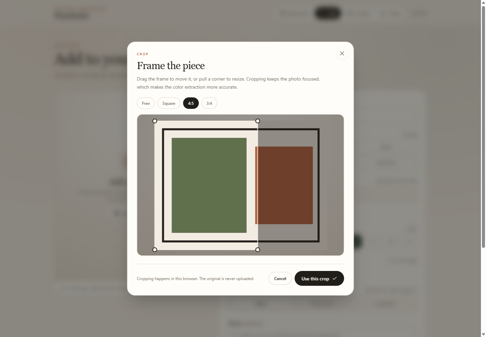
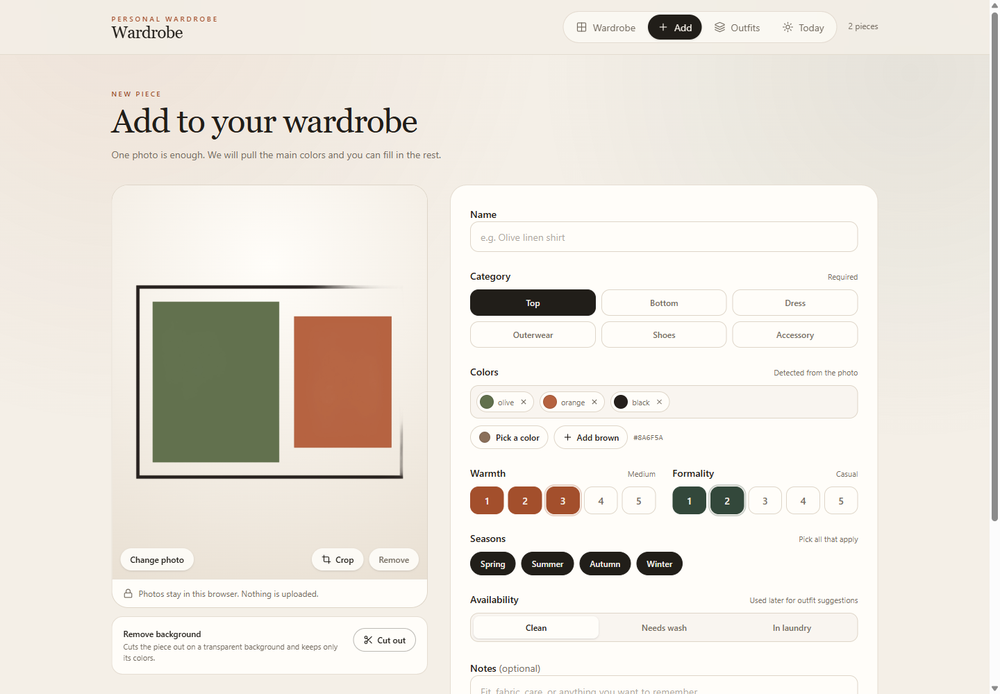
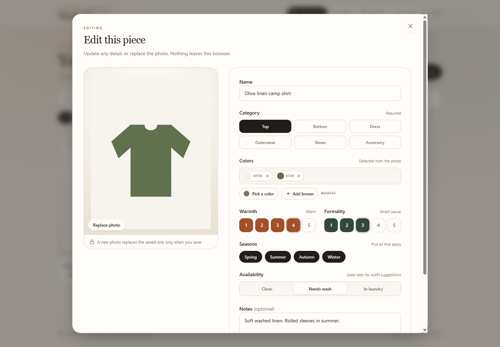
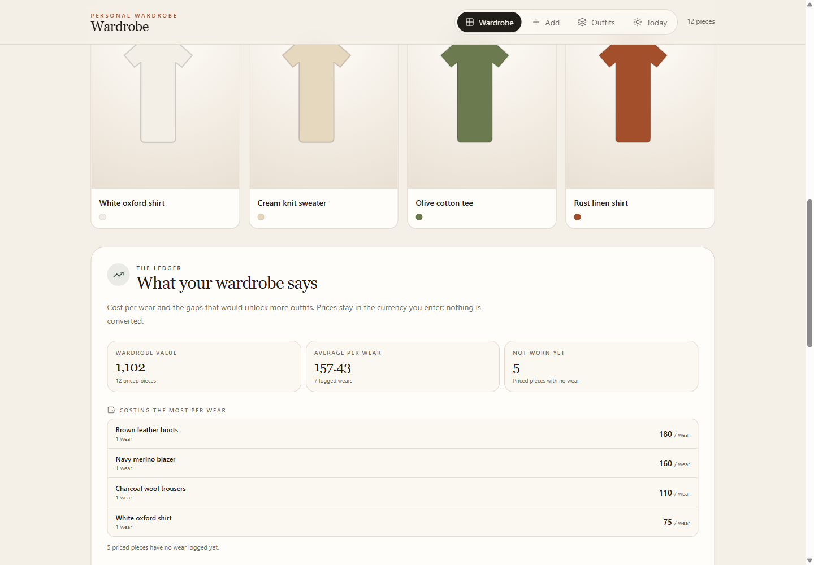
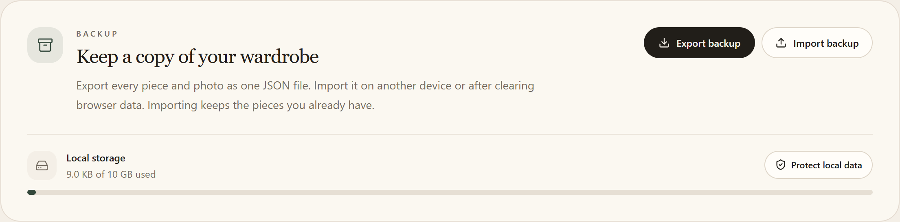
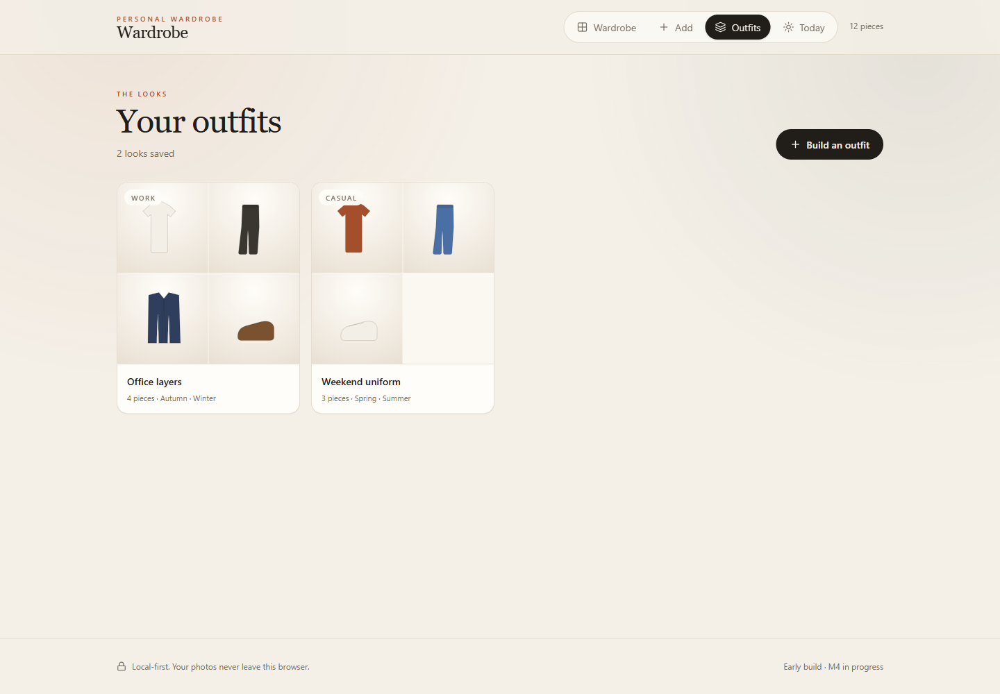
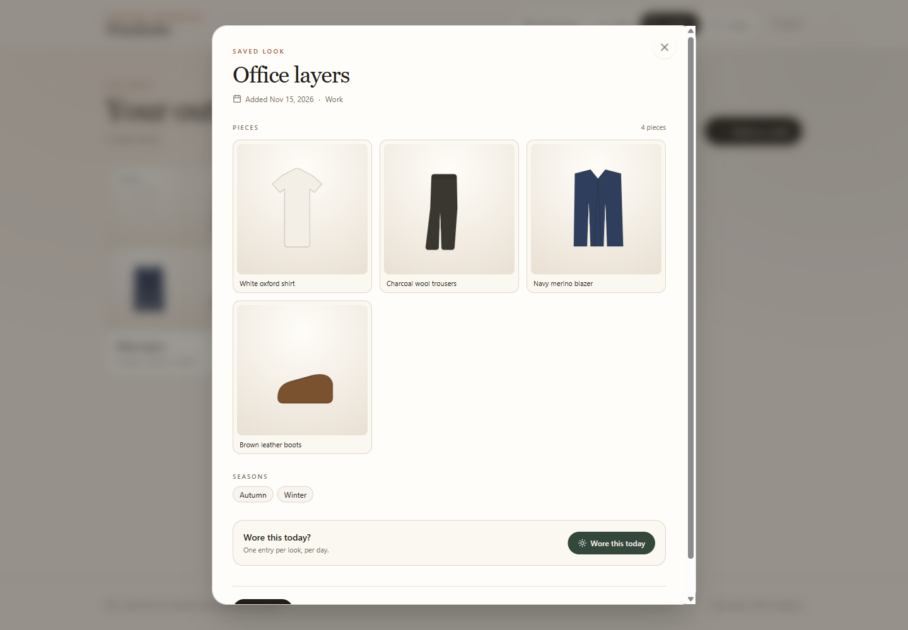
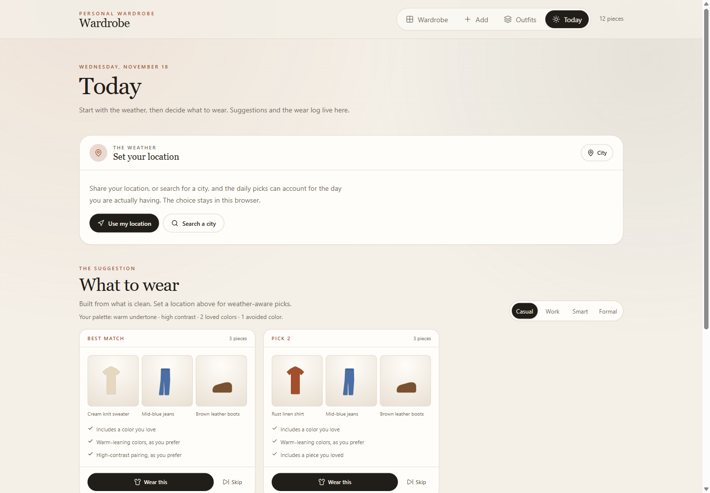
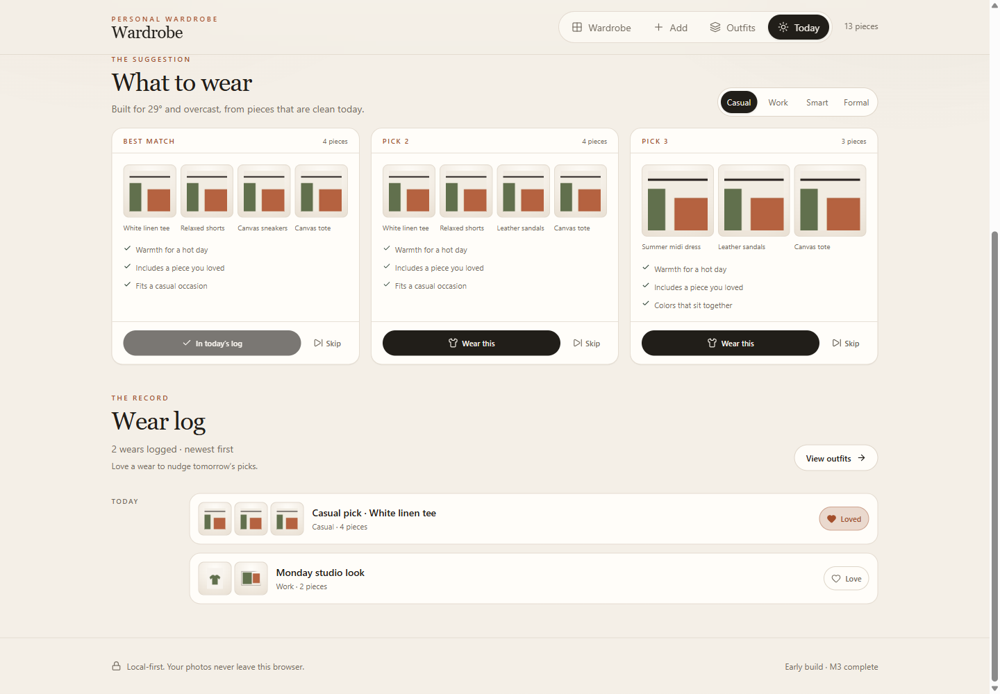
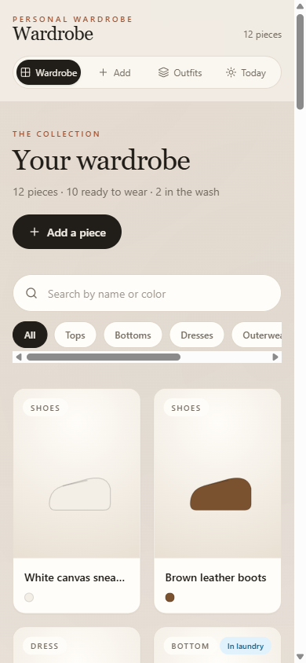

# Wardrobe

A local-first virtual wardrobe. Add a garment with one photo, let the app pull its main colors, and build a closet you can actually use. The long-term goal is a daily outfit suggestion based on the weather, the occasion, and what is clean.

> **Status: M5 shipped.** Add, edit, crop, cut out, and back up a local wardrobe, build and save looks from it, keep a wear log, check today's weather, and get daily outfit suggestions. A photo can now seed a reviewable draft of the garment's details; the free default recognizes colors locally, with an optional self-hosted vision path. See what each piece costs per wear and which wardrobe gaps are worth filling. Install it to your home screen and reopen it offline. By default, everything personal stays in your browser — no account, no backend, no paid API.

**Live:** https://hanandibud.github.io/wardrobe/


## What works today
- Add a piece from a photo (camera or library on mobile)
- Crop the photo before saving, or re-crop a saved one, with free, square, 4:5, and 3:4 frames
- Remove the background in the browser, leaving the piece on a transparent cutout
- Detect the main colors automatically in CIELAB space
- Recognize a photo into a reviewable draft: type, colors, pattern, material, fit, sleeve, formality, warmth, seasons, and occasions
- Mark uncertain predictions, reject any single guess, correct the rest, and retry; nothing is saved until you confirm
- Keep the full add flow working offline and when recognition fails (the default recognizer is local and keyless)
- Record category, warmth, formality, seasons, availability, and notes
- Edit any detail of a saved piece, including replacing its photo
- Export pieces, photos, looks, and the wear log to one JSON file
- Import it on another device or after clearing browser data; older backups still restore their pieces
- Browse, search, and filter the wardrobe
- Build an outfit from pieces you own, with a name, occasion, and seasons
- Save looks and browse them newest first
- Open a saved look to see its pieces, rename it, or remove it
- Log that you wore a look today, once per day
- See the wear log newest first, grouped by day
- See today’s weather from Open-Meteo using your location or a city search
- Cache the weather for half an hour and refresh it on demand
- Get up to three outfit picks built from clean pieces, with a reason for each
- Choose casual, work, smart, or formal before picking
- Press “Wear this” to save the look and log the wear in one step
- Skip a pick for the rest of the day
- Love a wear in the log so pieces from that look rise in later picks
- Record what a piece cost and see the cost per wear across your logged wears
- See the wardrobe gaps worth noticing: a base, a formal option, warmth at both ends, shoes, and a neutral
- Install the app to your home screen and open it offline
- Open a piece to see its details
- Mark a piece clean, needs wash, or in laundry
- Remove a piece
- Local persistence with IndexedDB — refresh and it is still there
- See local storage usage, request persistent storage, and get a clear warning when it runs low























## Planned

- A short demo animation

See [docs/roadmap.md](docs/roadmap.md) for the order and acceptance criteria.

## Free by design

The MVP intentionally avoids services that can start charging:

| Need | Choice | Cost |
| --- | --- | --- |
| Hosting | GitHub Pages | Free for public repos |
| Database | IndexedDB (browser) | Free |
| Auth | None — single local user | Free |
| Weather | Open-Meteo | Free, no API key |
| Background removal | In-browser model (`@imgly/background-removal`) | Free; model fetched once from a public CDN |
| Garment recognition | Local heuristic by default; optional self-hosted vision | Free by default, no key |
| CI | GitHub Actions | Free tier |

No Vercel, Supabase, or paid AI API is required. If the app later needs multi-device sync, Supabase's free tier is a reasonable next step — but it is not part of the local-first MVP.

## Stack

- React 19 + TypeScript + Vite
- Tailwind CSS v4
- Dexie (IndexedDB)
- `culori` for color conversion and Delta E
- `@imgly/background-removal` on `onnxruntime-web` for the in-browser cutout
- Lucide icons
- Open-Meteo for weather (keyless)
- GitHub Pages (live)

## Recognition

Every photo starts a draft. The shipped provider is local, keyless, and
offline: it reuses the app's color extractor and fills **colors only**. Type,
pattern, material, fit, sleeve, and the scoring hints stay blank rather than
being guessed from pixels. The draft is ordinary editable form fields. AI
confidence is shown as a model estimate, not a calibrated probability; values
at or below 0.6 are marked “low confidence”, each applied row can be rejected,
and nothing reaches IndexedDB until you press **Save to wardrobe**. In edit mode
recognition only runs from the explicit **Analyze photo** action, and saved
fields are never overwritten. Locally measured colors remain authoritative.

An optional vision path can fill the rest. Deploy [`server/recognize.ts`](server/recognize.ts)
at `/api/recognize` on a host you control, then set:

```dotenv
# Browser-visible, not a secret
VITE_RECOGNITION_PROVIDER=ai

# Server-only — never prefix with VITE_
RECOGNITION_API_KEY=your-key
RECOGNITION_API_URL=https://api.openai.com/v1/chat/completions
RECOGNITION_MODEL=gpt-4o-mini
RECOGNITION_RATE_LIMIT_PER_MINUTE=20
# RECOGNITION_ALLOWED_ORIGINS=https://your-site.example
```

The client validates the function's response through the same schema used for
every provider. A payload like this fills the form; unknown values are dropped
rather than trusted. The live GitHub Pages build stays on the local default and
does not deploy this function.

The reference endpoint has **not** been exercised against a live vision provider
in this repository. Treat it as a starting point, and run a real provider
integration test before relying on it.

The reference function is **not** a production-ready public proxy. It caps the
request body, validates image signatures, times out at 15 seconds, and has an
in-memory single-instance limiter, but no authentication or distributed rate
limiting. Add platform abuse protection and a provider spending cap before
exposing a paid key publicly; CORS is not authentication.

```json
{
  "attributes": {
    "name": "Olive linen camp shirt",
    "category": "top",
    "subcategory": "shirt",
    "colors": ["#60704d", "#f6f3ee"],
    "pattern": "solid",
    "material": "linen",
    "fit": "regular",
    "formality": 2,
    "warmth": 2,
    "sleeve": "short",
    "seasons": ["spring", "summer"],
    "occasions": ["everyday", "work"]
  },
  "confidence": {
    "category": 0.94,
    "subcategory": 0.86,
    "pattern": 0.72,
    "material": 0.55,
    "fit": 0.63,
    "formality": 0.7,
    "warmth": 0.61,
    "sleeve": 0.88
  }
}
```

Confidence is the model’s own 0–1 estimate, not a calibrated probability. Values
at or below 0.6 are marked “low confidence”, and every applied row is labelled
“model estimate”. The request contains one downscaled WebP (longest edge
1024 px) as `{ imageBase64, mimeType }` and no wardrobe data. Network failures
and transient 5xx responses retry once; timeouts, authentication failures, other
4xx responses, rate limits, and cancellations do not. The result then falls back
to the local heuristic with a visible warning. See [setup](docs/setup.md) for the
server configuration and [ADR 0004](docs/decisions/0004-garment-recognition.md)
for the trade-offs.

## Run it

```bash
npm install
npm run dev
```

Open the local URL Vite prints. To use it on your phone, connect both devices to the same Wi-Fi and open the **Network** URL. Windows Firewall may ask for permission the first time.

## Install it

The production build is a PWA. The [live site](https://hanandibud.github.io/wardrobe/) is the easiest place to install it:

- **Android / Chrome:** open the site, then use the browser menu → **Install app** (or the install icon in the address bar).
- **iPhone / Safari:** open the site, tap **Share**, then **Add to Home Screen**.

Once opened online, the app shell is cached, so the wardrobe, add form, outfits, and wear log keep working offline. Two things still need a connection: a weather refresh, and the first background removal of a session (the cutout model is ~40 MB and deliberately not cached).

After a deploy, the app revalidates the shell on each online open, so updates arrive without reinstalling. Most changes show up on the next open; an update to the offline worker itself may take one extra open.

Useful commands:

```bash
npm run dev        # local dev server
npm run build      # typecheck + production build
npm run typecheck  # TypeScript only
npm run lint       # Oxlint
npm test           # unit tests (Vitest)
npm run preview    # preview the production build
```

## Project structure

```text
src/
  App.tsx                 app shell, tabs, toast, item actions
  db.ts                   Dexie database and tables
  types.ts                domain types and option lists
  components/
    Header.tsx            brand + navigation
    WardrobeView.tsx      grid, search, filters, empty state
    ItemCard.tsx          wardrobe card
    ItemDetail.tsx        item dialog with edit mode
    ItemForm.tsx          shared add/edit form and photo pipeline
    RecognitionPanel.tsx  review card for recognized attributes
    ItemThumbnail.tsx     small decorated image shared by outfit views
    OutfitsView.tsx       saved looks grid, empty states, builder switch
    OutfitBuilder.tsx     name, occasion, seasons, piece picker
    OutfitDetail.tsx      outfit dialog with rename, wear, and delete
    TodayView.tsx         today page shell: heading, weather, suggestions, log
    WeatherPanel.tsx      location search, cache, and current conditions
    SuggestionsPanel.tsx  occasion picker, cards, wear this, skip
    WearHistoryView.tsx   wear log grouped by day
    CropDialog.tsx        crop frame with drag and resize handles
    BackupPanel.tsx       export/import controls and status
    InsightsPanel.tsx     cost per wear and wardrobe gap insights
    StorageStatus.tsx     storage usage meter and persistence request
    AddItemView.tsx       add page shell
  hooks/
    useObjectUrl.ts       object URL lifecycle for Blob images
    useRecognition.ts     recognition state, retry, and stale-run guard
  lib/
    backup.ts             v2 JSON backup: pieces, looks, wear log
    colors.ts             k-means palette extraction, color names, neutral/hue helpers
    crop.ts               crop geometry and canvas cropping
    cutout.ts             in-browser background removal wrapper
    images.ts             image validation and WebP compression
    insights.ts           price parsing, cost per wear, wardrobe gaps
    outfits.ts            selection toggling, category groups, item resolution
    recommend.ts          hard filters, combos, scoring, reasons, skips
    recognition/          provider contract, vocab, validation, client, providers
    storage.ts            storage estimate, persistence, quota detection
    wear.ts               local dates, wear labels, history join
    weather.ts            Open-Meteo fetch, WMO mapping, bands, cache
    *.test.ts             Vitest unit tests for the pure logic
docs/                     product, architecture, setup, roadmap, ADRs
server/
  recognize.ts            optional server-side vision function (not bundled)
public/
  manifest.webmanifest    PWA name, colors, and icons
  sw.js                   offline shell cache and fetch strategy
  icons/                  install icons (192, 512, maskable)
scripts/
  demo-seed.mjs           browser seed that fills the wardrobe with a demo closet for screenshots
screenshots/              documentation screenshots
```

## Privacy

- Photos and wardrobe data are stored in IndexedDB in your browser.
- In the default build, photos are never uploaded. Background removal, color extraction, and the heuristic recognizer run locally; only the cutout model file is downloaded.
- If a site owner enables the optional AI recognizer (`VITE_RECOGNITION_PROVIDER=ai`), a downscaled 1024 px WebP copy is posted to their `/api/recognize` function and forwarded to the configured vision provider. The add form says so explicitly when that mode is active. No wardrobe data, names, or notes are sent. If the browser cannot prepare the image safely, the original is not uploaded and the app stays local.
- The AI path keeps its API key in the server environment. No key is present in the client bundle, and no key is required for the default app. The reference function is not deployed by this project and is not a public proxy; a deployer must add abuse protection and a spending cap before enabling it.
- The weather request sends only rounded coordinates to Open-Meteo, a keyless free service. The chosen place and last reading stay in `localStorage`. When you search for a city, the place name you type is sent to Open-Meteo's geocoder to find matching coordinates.
- Skipped picks for the current day are kept in `localStorage` too; they never leave the browser.
- The service worker caches the app shell (HTML, JavaScript, CSS, icons) in the browser’s Cache Storage. It never caches photos, API responses, or the cutout model.
- IndexedDB is per browser and per device. Clearing site data deletes the wardrobe unless you keep a backup. Export/import is built in.
- Backup files contain your photos. Treat them like personal documents and do not commit or share them.

## Documentation

- [Product brief](docs/PRD.md)
- [Architecture](docs/architecture.md)
- [Data model](docs/data-model.md)
- [Roadmap](docs/roadmap.md)
- [Setup and GitHub](docs/setup.md)
- [Devlog](docs/devlog.md)
- [Decisions](docs/decisions/)

## License

AGPL-3.0-or-later. See [LICENSE](LICENSE).

The app is licensed under the AGPL because its background removal depends on
[`@imgly/background-removal`](https://github.com/imgly/background-removal-js), which is
AGPL-3.0. Everything else in the repo is original work. If you fork it, keep the license and
publish your source under the same terms.
