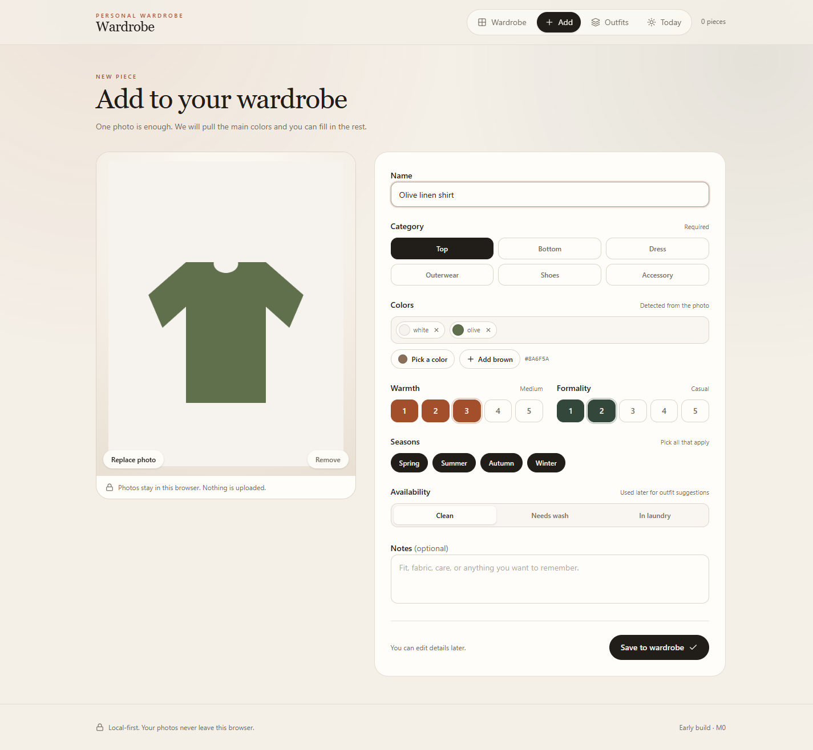
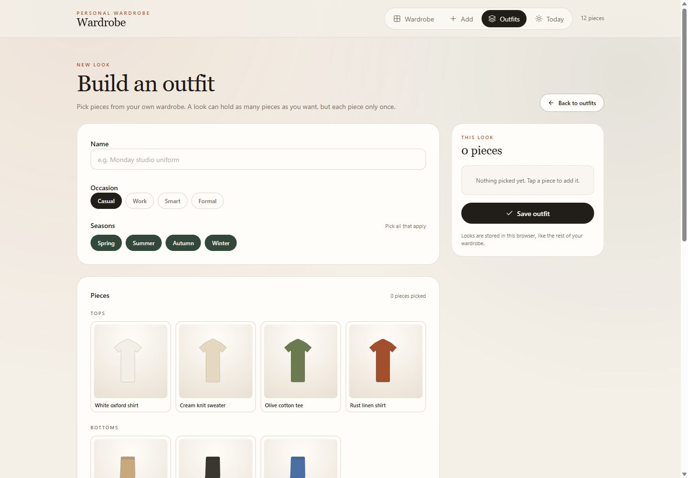
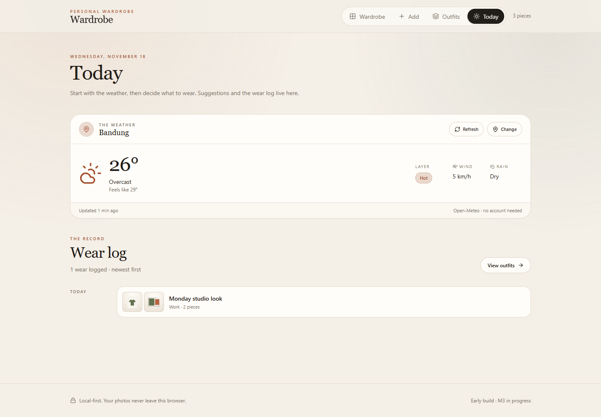
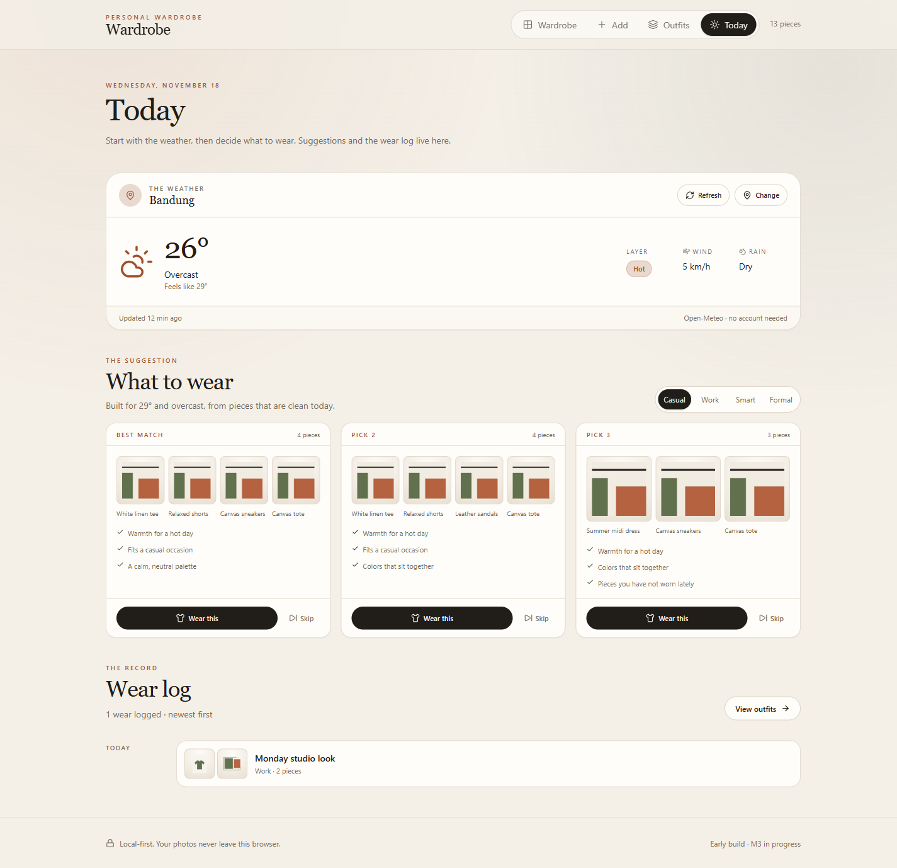

# Wardrobe

A local-first virtual wardrobe. Add a garment with one photo, let the app pull its main colors, and build a closet you can actually use. The long-term goal is a daily outfit suggestion based on the weather, the occasion, and what is clean.

> **Status: M4 in progress.** Add, edit, crop, cut out, and back up a local wardrobe, build and save looks from it, keep a wear log, check today’s weather, and get daily outfit suggestions tuned by your color palette. Install it to your home screen and reopen it offline. Everything personal stays in your browser — no account, no backend, no paid API.

**Live:** https://hanandibud.github.io/wardrobe/


## What works today

- Add a piece from a photo (camera or library on mobile)
- Crop the photo before saving, or re-crop a saved one, with free, square, 4:5, and 3:4 frames
- Remove the background in the browser, leaving the piece on a transparent cutout
- Detect the main colors automatically in CIELAB space
- Record category, warmth, formality, seasons, availability, and notes
- Edit any detail of a saved piece, including replacing its photo
- Export pieces, photos, looks, and the wear log to one JSON file
- Import it on another device or after clearing browser data; older backups still restore their pieces
- Browse, search, and filter the wardrobe
- Build an outfit from pieces you own, with a name, occasion, and seasons
- Save looks and browse them newest first
- Open a saved look to see its pieces, rename it, or remove it
- Log that you wore a look today, once per day
- See the wear log newest first, grouped by day
- See today’s weather from Open-Meteo using your location or a city search
- Cache the weather for half an hour and refresh it on demand
- Get up to three outfit picks built from clean pieces, with a reason for each
- Choose casual, work, smart, or formal before picking
- Press “Wear this” to save the look and log the wear in one step
- Skip a pick for the rest of the day
- Love a wear in the log so pieces from that look rise in later picks
- Set loved and avoided colors, an undertone, and a contrast preference; picks use them as small tie-breakers
- Install the app to your home screen and open it offline
- Open a piece to see its details
- Mark a piece clean, needs wash, or in laundry
- Remove a piece
- Local persistence with IndexedDB — refresh and it is still there
- See local storage usage, request persistent storage, and get a clear warning when it runs low












## Planned

- Cost-per-wear and wardrobe gap insights
- Accessibility pass and a refreshed demo

See [docs/roadmap.md](docs/roadmap.md) for the order and acceptance criteria.

## Free by design

The MVP intentionally avoids services that can start charging:

| Need | Choice | Cost |
| --- | --- | --- |
| Hosting | GitHub Pages | Free for public repos |
| Database | IndexedDB (browser) | Free |
| Auth | None — single local user | Free |
| Weather | Open-Meteo | Free, no API key |
| Background removal | In-browser model (`@imgly/background-removal`) | Free; model fetched once from a public CDN |
| CI | GitHub Actions | Free tier |

No Vercel, Supabase, or paid AI API is required. If the app later needs multi-device sync, Supabase's free tier is a reasonable next step — but it is not part of the local-first MVP.

## Stack

- React 19 + TypeScript + Vite
- Tailwind CSS v4
- Dexie (IndexedDB)
- `culori` for color conversion and Delta E
- `@imgly/background-removal` on `onnxruntime-web` for the in-browser cutout
- Lucide icons
- Open-Meteo for weather (keyless)
- GitHub Pages (live)

## Run it

```bash
npm install
npm run dev
```

Open the local URL Vite prints. To use it on your phone, connect both devices to the same Wi-Fi and open the **Network** URL. Windows Firewall may ask for permission the first time.

## Install it

The production build is a PWA. The [live site](https://hanandibud.github.io/wardrobe/) is the easiest place to install it:

- **Android / Chrome:** open the site, then use the browser menu → **Install app** (or the install icon in the address bar).
- **iPhone / Safari:** open the site, tap **Share**, then **Add to Home Screen**.

Once opened online, the app shell is cached, so the wardrobe, add form, outfits, and wear log keep working offline. Two things still need a connection: a weather refresh, and the first background removal of a session (the cutout model is ~40 MB and deliberately not cached).

After a deploy, the app revalidates the shell on each online open, so updates arrive without reinstalling. Most changes show up on the next open; an update to the offline worker itself may take one extra open.

Useful commands:

```bash
npm run dev        # local dev server
npm run build      # typecheck + production build
npm run typecheck  # TypeScript only
npm run lint       # Oxlint
npm test           # unit tests (Vitest)
npm run preview    # preview the production build
```

## Project structure

```text
src/
  App.tsx                 app shell, tabs, toast, item actions
  db.ts                   Dexie database and tables
  types.ts                domain types and option lists
  components/
    Header.tsx            brand + navigation
    WardrobeView.tsx      grid, search, filters, empty state
    ItemCard.tsx          wardrobe card
    ItemDetail.tsx        item dialog with edit mode
    ItemForm.tsx          shared add/edit form and photo pipeline
    ItemThumbnail.tsx     small decorated image shared by outfit views
    OutfitsView.tsx       saved looks grid, empty states, builder switch
    OutfitBuilder.tsx     name, occasion, seasons, piece picker
    OutfitDetail.tsx      outfit dialog with rename, wear, and delete
    TodayView.tsx         today page shell: heading, weather, suggestions, log
    WeatherPanel.tsx      location search, cache, and current conditions
    SuggestionsPanel.tsx  occasion picker, cards, wear this, skip
    WearHistoryView.tsx   wear log grouped by day
    CropDialog.tsx        crop frame with drag and resize handles
    BackupPanel.tsx       export/import controls and status
    PalettePanel.tsx      palette, undertone, and contrast preferences
    StorageStatus.tsx     storage usage meter and persistence request
    AddItemView.tsx       add page shell
  hooks/
    useObjectUrl.ts       object URL lifecycle for Blob images
  lib/
    backup.ts             v2 JSON backup: pieces, looks, wear log
    colors.ts             k-means palette extraction, color names, neutral/hue helpers
    crop.ts               crop geometry and canvas cropping
    cutout.ts             in-browser background removal wrapper
    images.ts             image validation and WebP compression
    outfits.ts            selection toggling, category groups, item resolution
    preferences.ts        palette storage, color matching, tone, contrast
    recommend.ts          hard filters, combos, scoring, reasons, skips
    storage.ts            storage estimate, persistence, quota detection
    wear.ts               local dates, wear labels, history join
    weather.ts            Open-Meteo fetch, WMO mapping, bands, cache
    *.test.ts             Vitest unit tests for the pure logic
docs/                     product, architecture, setup, roadmap, ADRs
public/
  manifest.webmanifest    PWA name, colors, and icons
  sw.js                   offline shell cache and fetch strategy
  icons/                  install icons (192, 512, maskable)
screenshots/              documentation screenshots
```

## Privacy

- Photos and wardrobe data are stored in IndexedDB in your browser.
- Photos are never uploaded. Background removal runs locally; only the model file is downloaded.
- The weather request sends only rounded coordinates to Open-Meteo, a keyless free service. The chosen place and last reading stay in `localStorage`.
- Skipped picks for the current day are kept in `localStorage` too; they never leave the browser.
- Color preferences are stored in `localStorage` on this device. They are not part of a backup and are never sent anywhere.
- The service worker caches the app shell (HTML, JavaScript, CSS, icons) in the browser’s Cache Storage. It never caches photos, API responses, or the cutout model.
- IndexedDB is per browser and per device. Clearing site data deletes the wardrobe unless you keep a backup. Export/import is built in.
- Backup files contain your photos. Treat them like personal documents and do not commit or share them.

## Documentation

- [Product brief](docs/PRD.md)
- [Architecture](docs/architecture.md)
- [Data model](docs/data-model.md)
- [Roadmap](docs/roadmap.md)
- [Setup and GitHub](docs/setup.md)
- [Devlog](docs/devlog.md)
- [Decisions](docs/decisions/)

## License

AGPL-3.0-or-later. See [LICENSE](LICENSE).

The app is licensed under the AGPL because its background removal depends on
[`@imgly/background-removal`](https://github.com/imgly/background-removal-js), which is
AGPL-3.0. Everything else in the repo is original work. If you fork it, keep the license and
publish your source under the same terms.
