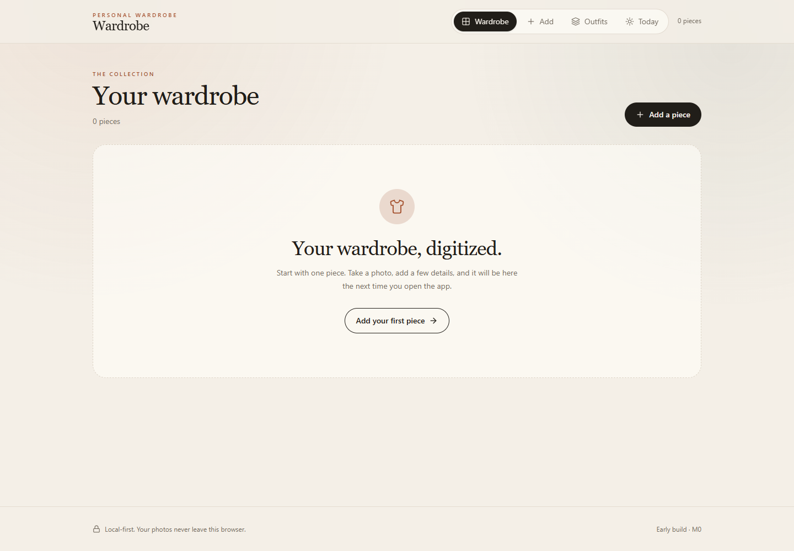

# Wardrobe

A local-first virtual wardrobe. Add a garment with one photo, let the app pull its main colors, and build a closet you can actually use. The long-term goal is a daily outfit suggestion based on the weather, the occasion, and what is clean.

> **Status: M1 in progress.** Add, edit, and browse a local wardrobe. Everything is stored in your browser — no account, no backend, no paid API.

**Live:** https://hanandibud.github.io/wardrobe/



## What works today

- Add a piece from a photo (camera or library on mobile)
- Detect the main colors automatically in CIELAB space
- Record category, warmth, formality, seasons, availability, and notes
- Edit any detail of a saved piece, including replacing its photo
- Browse, search, and filter the wardrobe
- Open a piece to see its details
- Mark a piece clean, needs wash, or in laundry
- Remove a piece
- Local persistence with IndexedDB — refresh and it is still there


## Planned

- Manual crop and background removal
- Export/import backup
- Outfit builder and saved looks
- Weather-aware daily suggestions
- Wear history and feedback
- Installable PWA
- Skin-tone and color-preference tuning (as a preference, not a scientific claim)

See [docs/roadmap.md](docs/roadmap.md) for the order and acceptance criteria.

## Free by design

The MVP intentionally avoids services that can start charging:

| Need | Choice | Cost |
| --- | --- | --- |
| Hosting | GitHub Pages | Free for public repos |
| Database | IndexedDB (browser) | Free |
| Auth | None — single local user | Free |
| Weather | Open-Meteo | Free, no API key |
| Background removal | Local `rembg` (optional) | Free |
| CI | GitHub Actions | Free tier |

No Vercel, Supabase, or paid AI API is required. If the app later needs multi-device sync, Supabase's free tier is a reasonable next step — but it is not part of the local-first MVP.

## Stack

- React 19 + TypeScript + Vite
- Tailwind CSS v4
- Dexie (IndexedDB)
- `culori` for color conversion and Delta E
- Lucide icons
- Open-Meteo (planned)
- GitHub Pages (live)

## Run it

```bash
npm install
npm run dev
```

Open the local URL Vite prints. To use it on your phone, connect both devices to the same Wi-Fi and open the **Network** URL. Windows Firewall may ask for permission the first time.

Useful commands:

```bash
npm run dev        # local dev server
npm run build      # typecheck + production build
npm run typecheck  # TypeScript only
npm run lint       # Oxlint
npm run preview    # preview the production build
```

## Project structure

```text
src/
  App.tsx                 app shell, tabs, toast, item actions
  db.ts                   Dexie database and tables
  types.ts                domain types and option lists
  components/
    Header.tsx            brand + navigation
    WardrobeView.tsx      grid, search, filters, empty state
    ItemCard.tsx          wardrobe card
    ItemDetail.tsx        item dialog with edit mode
    ItemForm.tsx          shared add/edit form and photo pipeline
    AddItemView.tsx       add page shell
    ComingSoon.tsx        roadmap placeholders
  hooks/
    useObjectUrl.ts       object URL lifecycle for Blob images
  lib/
    colors.ts             k-means palette extraction + color names
    images.ts             image validation and WebP compression
docs/                     product, architecture, setup, roadmap, ADRs
screenshots/              documentation screenshots
```

## Privacy

- Photos and wardrobe data are stored in IndexedDB in your browser.
- Nothing is uploaded by the current app.
- The future weather request will send only coordinates to Open-Meteo.
- IndexedDB is per browser and per device. Clearing site data deletes the wardrobe. Export/import is on the roadmap.

## Documentation

- [Product brief](docs/PRD.md)
- [Architecture](docs/architecture.md)
- [Data model](docs/data-model.md)
- [Roadmap](docs/roadmap.md)
- [Setup and GitHub](docs/setup.md)
- [Devlog](docs/devlog.md)
- [Decisions](docs/decisions/)

## License

MIT. See [LICENSE](LICENSE).
