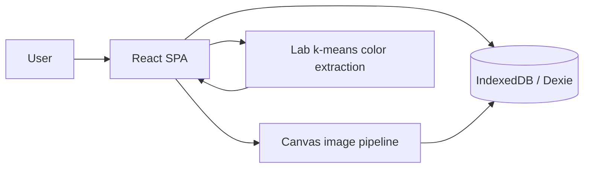
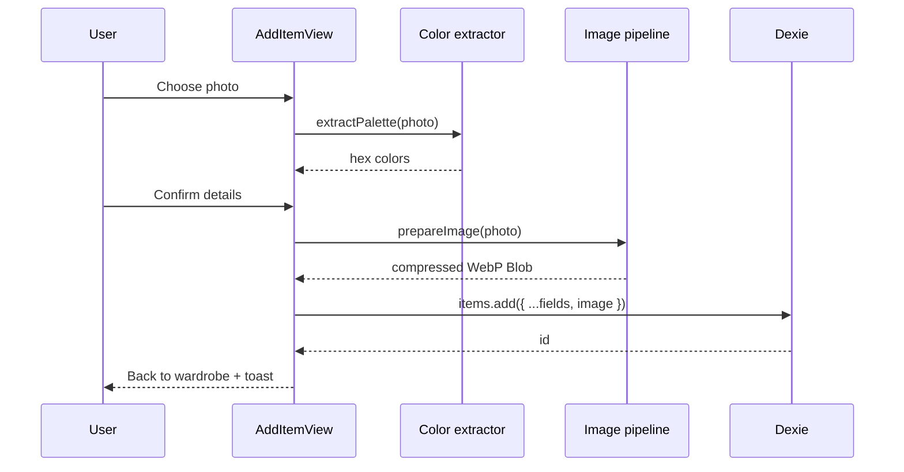

# Architecture

## Current shape (M2 in progress)



There is no backend, no account, and no network request in the current app. The browser is the product.

## Why local-first

- **Free:** no hosting database, no storage bill, no auth service.
- **Private:** photos never leave the device.
- **Simple:** one static build instead of an API, workers, and a database.
- **Fast:** reading local data does not wait on a network.
- **Honest trade-off:** data lives in one browser profile on one device. Export/import is the escape hatch, and optional sync comes later.

## Components

### `src/App.tsx`

Owns the app shell: active tab, selected item, toast, and the live query to Dexie. It passes callbacks down; feature components stay mostly presentational.

### `src/components/ItemForm.tsx`

One form powers both capture and editing. It seeds state from an optional saved item, validates and compresses a new photo, extracts a palette, and writes with either `items.add` or `items.update`. `AddItemView` wraps it as a page; `ItemDetail` mounts it in edit mode with a cancel path. Replacing a photo only touches the saved Blob when the user saves the form.

### `src/db.ts`

Dexie database named `wardrobe` with three tables:

- `items` — wardrobe pieces
- `outfits` — saved combinations of item ids, with occasion and seasons
- `wearEvents` — wear history and feedback (schema ready, UI later)

Images are stored as `Blob` values inside the item row. The current schema version is 1. Future schema changes must add a new `db.version(n).stores(...)` migration rather than editing version 1.

### `src/lib/images.ts`

1. Validate MIME type and a 20 MB upload ceiling.
2. `createImageBitmap(file)`.
3. Downscale so the longest edge is at most 1600 px.
4. Draw to a canvas and encode WebP at quality 0.86.
5. Store the resulting Blob.

Downscaling keeps IndexedDB usage predictable. The original file is intentionally not kept; if re-processing is needed later, the user can re-upload.

### `src/lib/crop.ts`

Pure geometry plus one canvas call. `fitRect` places the photo inside the crop stage, `defaultCrop` picks the centered starting frame for an aspect ratio, `clampCrop` keeps a frame inside the image, and `resizeCrop` resizes from a corner while preserving the ratio and the opposite anchor. `cropImageToFile` draws the selected region at natural resolution and returns a WebP `File`, so the existing validation and compression pipeline stays unchanged.

### `src/components/CropDialog.tsx`

A modal that opens whenever a photo is chosen or the user presses Crop on an existing one. The frame is dragged with pointer capture, four corners resize it, and four shape presets (free, square, 4:5, 3:4) lock the ratio. The photo is inset from the stage edge so the handles never sit on the clipped boundary. Escape and the backdrop cancel without touching the saved photo; the cropped result only reaches the form after Use this crop.

### `src/lib/cutout.ts`

Wraps the in-browser cutout so the form never imports the model directly. `cutOutBackground` lazily imports `@imgly/background-removal`, runs the smallest model (`isnet_quint8`), and returns a PNG so transparency survives. The model and its WASM runtime are fetched on first use from the package's public CDN — never bundled into the app — which keeps the main chunk small and needs no key. Progress keys map through the pure `describeCutoutStage`, so the UI can show Downloading the model → Removing the background → Preparing the photo.

The library memoizes model loading by `JSON.stringify(config)`, which means a failed load stays failed for the rest of the page session. `cutoutConfig` therefore carries a small attempt offset; since a PNG ignores `quality`, the offset changes only the memo key. That is what makes Retry work without a page reload.

The cutout only replaces the working photo in the form. Saving is still deferred, so a bad cutout is discarded by leaving the form.

### `src/lib/outfits.ts`

Pure helpers behind the outfit UI, kept out of the components so they are testable:

- `toggleItemSelection` adds a piece or removes it, and can never produce a duplicate.
- `groupItemsByCategory` puts the wardrobe in category order for the picker and drops empty groups.
- `resolveOutfitItems` maps saved ids back to rows in the saved order; ids whose item was deleted simply disappear.
- `pieceCountLabel` handles the singular/plural copy.

### `src/components/OutfitsView.tsx`

Owns the outfits tab. A `useLiveQuery` reads `outfits` newest first. The page has three states: wardrobe empty (send the user to Add), no saved looks, and the card grid. Each card shows up to four pieces in a fixed collage, the occasion, the name, the piece count, and the seasons. The collage sits in an absolutely positioned grid inside an `aspect-square` frame so a tall photo cannot stretch the card. Cards are buttons that open the detail dialog; switching to the builder is local state, and saving returns to the list with a toast.

### `src/components/OutfitBuilder.tsx`

The build form: name, one occasion, any seasons, and a category-grouped piece picker. A sticky summary shows the running count and up to eight thumbnails, and the save button stays disabled until the wardrobe has something in it. Validation is inline: a name is required and at least one piece must be picked. Writes go straight to `db.outfits.add`; there is no draft table.

### `src/components/OutfitDetail.tsx`

The read view for a saved look: the name, when it was saved, the occasion, every piece with its name, and the season chips. Rename is an inline form over the dialog with its own validation; delete asks for confirmation before `db.outfits.delete`. The dialog keeps the focus on its close button, locks body scroll, and uses Escape to cancel a rename first, then to close. Deleted wardrobe pieces are counted and named as missing rather than silently dropped. After a rename, the parent's live query refreshes the heading in place.

### `src/components/ItemThumbnail.tsx`

A shared decorative thumbnail for outfit collages and summary strips. It creates and revokes an object URL for the item Blob, marks the image `aria-hidden`, and relies on the name rendered beside it. Pieces without a photo fall back to a quiet "No photo" block.

### `src/lib/backup.ts`

A backup is one JSON file with the full item list and each photo embedded as a data URL. `downloadBackup` reads the items in `createdAt` order, converts every Blob, and triggers a browser download. `importBackup` parses and validates the file, converts the images back to Blobs, and bulk-adds them in one transaction.

Import is additive and idempotent: an item is skipped when its `name` + `createdAt` key already exists, so importing the same file twice does not duplicate the wardrobe. Malformed top-level files fail with a readable message; individual malformed items are skipped and counted. Photos make backups personal data, so the UI warns the user to keep the file safe.

### `src/lib/storage.ts`

Wraps `navigator.storage` so the UI never calls it directly. `getStorageUsage` returns usage, quota, and a percentage from `estimate()`, plus the persisted flag; `requestPersistentStorage` asks `persist()` and swallows a rejection. `formatBytes` renders a friendly size, and `isQuotaError` recognises the `QuotaExceededError` family so both save and import can show a specific "out of storage" message instead of a generic failure.

`StorageStatus` renders the meter inside the backup panel and keeps three states distinct: checking, unsupported, and reported. It shows an alert above 85% and, if the browser refuses persistence, tells the user to keep a backup.

### `src/lib/colors.ts`

Color extraction is deterministic and local:

1. Draw the photo to a 160 px canvas.
2. Sample up to roughly 6,000 opaque pixels, skipping transparency.
3. Convert each pixel to CIELAB.
4. Run k-means with `maxColors + 2` clusters for 10 iterations.
5. Sort clusters by population and merge centroids closer than a Lab distance threshold.
6. Convert centroids back to hex.
7. Map each hex to the nearest human-readable color name with CIEDE2000.

This is intentionally simpler than a trained fashion attribute model. It is fast, explainable, and good enough to seed the color field. The user can add or remove colors manually.

The canvas work is a thin wrapper: `paletteFromImage` takes a raw RGBA buffer and does the sampling, clustering, and naming, which keeps the interesting part pure and testable. Only `extractPalette` touches `createImageBitmap` and `getImageData`.

## Tests

`npm test` runs Vitest over the pure logic. No browser or DOM is needed, because the parts worth testing were kept free of canvas and storage calls:

- `colors.test.ts` — color naming, and palette extraction from a hand-built RGBA buffer.
- `crop.test.ts` — fit, default frame, clamping, and corner resizing, including ratio and bounds.
- `images.test.ts` — the accepted types and the 20 MB limit.
- `backup.test.ts` — version checks, broken files, skipped items, and field filtering.
- `storage.test.ts` — byte formatting and quota-error detection.
- `cutout.test.ts` — progress-key wording and the retry memo key for the cutout config.
- `outfits.test.ts` — toggling without duplicates, category grouping, resolving deleted items, and the piece count copy.

The canvas, IndexedDB, and pointer-drag paths are verified in a browser instead; they are covered by the manual checks recorded in the devlog. CI runs the tests between typecheck and build.

### `src/hooks/useObjectUrl.ts`

Creates an object URL for a Blob and revokes it on change/unmount. This avoids leaking memory when the wardrobe re-renders.

## Data flow: add a piece



## Planned pieces

## Background removal

Shipped in M1 as an in-browser cutout:

- The photo is passed to `@imgly/background-removal` in the same tab; nothing is uploaded.
- The model is a ~40 MB `isnet_quint8` ONNX file fetched on first use from a public CDN, so the catalog keeps working offline after the first cutout while the model stays cached.
- The output is a PNG, so the transparent background survives into the stored image. Color extraction skips pixels below alpha 180, so the palette becomes garment-only.
- The dependency is AGPL-3.0, which is why the repo license is AGPL-3.0.

Limits to remember: inference is CPU-bound and takes a few seconds, the first run is download-bound, and a blurry or busy background still yields a rough mask. The user can always skip the cutout.

### Weather

Open-Meteo, fetched directly from the browser:

- `current` / `hourly` feels-like temperature
- precipitation probability
- wind speed
- UV index (optional)

Only coordinates are sent. Cache the response for 30–60 minutes. The module boundary should make it possible to swap providers without touching the recommendation logic.

### Recommendation pipeline (M3)

```text
hard filters
  occasion + formality range
  season + weather band
  status = clean
  not worn in the last N days
        ↓
candidate generation
  top + bottom, or dress
  shoes
  optional outerwear
  optional accessory
        ↓
scoring
  color harmony (Delta E + neutral anchors)
  formality consistency
  warmth vs feels-like
  user preference weights
  novelty / recency
        ↓
top 3 + explanation
```

The first version is rules-based. With one user and a small wardrobe, learned ranking has nothing to learn from. Log feedback (`wore`, `skipped`, `loved`) and only consider weights later once there is enough history.

### Deployment

The Vite build is static. `base: './'` makes it portable to a GitHub Pages project URL (`https://<user>.github.io/wardrobe/`). The planned workflow builds `dist/` and deploys it with GitHub Pages. No server runtime is needed.

## Security and privacy

- No secrets or API keys exist in the client.
- No user photos are uploaded.
- Weather coordinates are the only planned network payload.
- Export files will contain personal wardrobe data; warn the user before sharing.
- If sync is added, authentication and row-level authorization become mandatory before the first sync.

## Constraints

- IndexedDB quota varies by browser; images should stay compressed.
- Data is per browser profile. Private browsing may evict storage.
- No background processing; heavy image work must stay off the main thread once it grows.
- A static site cannot hide API keys. Prefer keyless APIs or user-supplied keys.
