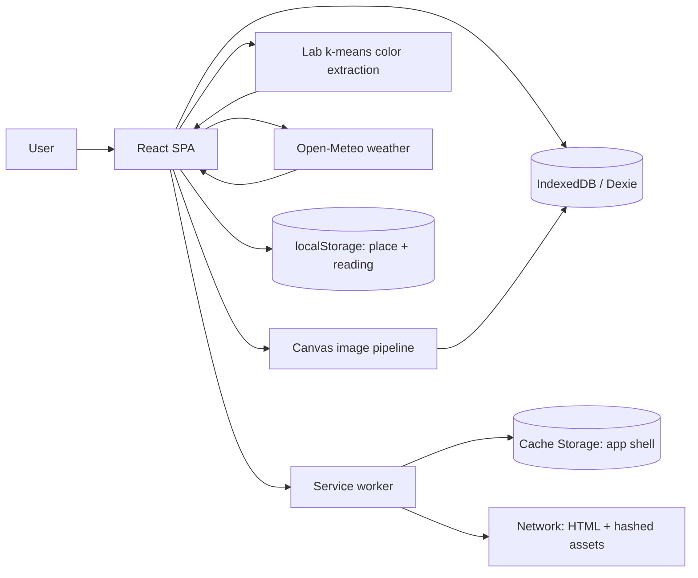
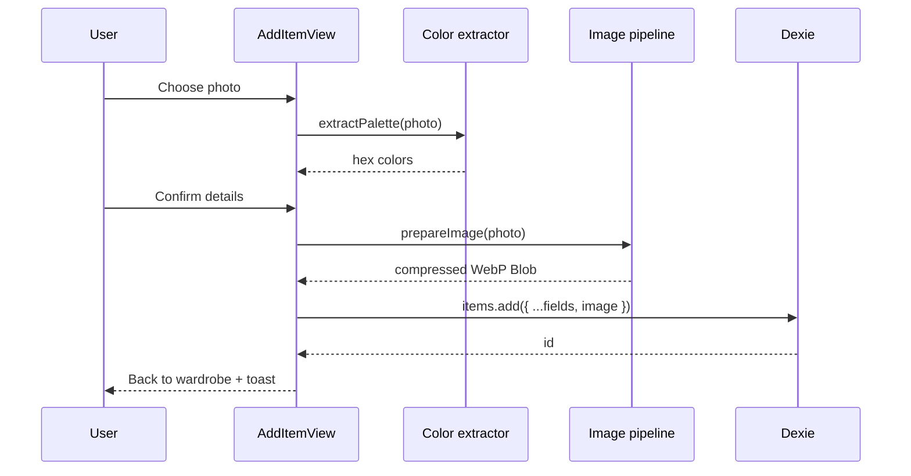

# Architecture

## Current shape (M4 in progress)



There is no backend and no account. Photos stay in IndexedDB. The only network requests are keyless: Open-Meteo weather and geocoding, plus the cutout model fetched from a public CDN on first use. The service worker is the only piece that sits between the app and the network for the shell itself.

## Why local-first

- **Free:** no hosting database, no storage bill, no auth service.
- **Private:** photos never leave the device.
- **Simple:** one static build instead of an API, workers, and a database.
- **Fast:** reading local data does not wait on a network.
- **Honest trade-off:** data lives in one browser profile on one device. Export/import is the escape hatch, and optional sync comes later.

## Installable shell (M4, shipped)

The production build is a PWA. No dependency was added; the manifest and worker are small enough to read in this repo.

- `public/manifest.webmanifest` — name, short name, description, paper theme, `standalone`, and relative `id`/`start_url`/`scope` so the same build works at a domain root or under `/wardrobe/`. Icons are 192, 512, and a maskable 512 generated from `public/icons/icon.svg`.
- `index.html` — links the manifest and the Apple touch icon, and adds the mobile web app meta tags. `theme-color` matches the paper background.
- `src/main.tsx` — registers `${BASE_URL}sw.js` after the window `load` event, production only, and swallows failures. A blocked worker never breaks the app; dev keeps the normal Vite reload flow.

### Service worker strategy

`public/sw.js` is deliberately small:

| Request | Strategy |
| --- | --- |
| Navigation | Network-first; cache the fresh HTML as `./index.html`; fall back to that cached copy offline |
| Same-origin asset | Cache-first; on a miss, fetch and store a 200 response |
| `.wasm` | Not intercepted, so the 24 MB cutout runtime is never cached |
| Cross-origin / outside scope | Not intercepted |

Install precaches `./`, `index.html`, the manifest, the favicon, and the install icons. It then fetches `index.html`, parses the hashed entry `./assets/*.js` and `*.css` out of it, and caches those too, so one online visit is enough to boot offline. `skipWaiting()` and `clients.claim()` make the first visit take control without a second reload. Activate deletes every cache except the current `CACHE_NAME`.

Storing the HTML network-first means a deploy is picked up on the next online load; the hashed assets are immutable, so cache-first is safe. Bump `CACHE_NAME` whenever the shell list or the strategy changes.

One browser detail is worth keeping in mind: Vite's preview server sends `Vary: Origin`, and module/stylesheet requests include an `Origin` header while the precached entries do not. Matching with `{ ignoreVary: true }` keeps the cached shell usable. Without it the HTML loaded offline but its JS and CSS did not.

### Offline limits

- The first visit must be online; after that the shell, wardrobe, add form, looks, and wear log all work offline.
- Weather refresh still needs a connection. The last reading stays visible.
- The first background removal still needs a connection; the ~40 MB model and the ONNX WASM are intentionally outside Cache Storage. Later cutouts in the same browsing session reuse the downloaded model.
- Cache Storage is device-local and is not part of a backup. Clearing site data removes it; the next online visit recreates it.
- Service workers require HTTPS or `localhost`, which GitHub Pages provides.

Verified on the production preview at 390 px: one online visit produced nine cache entries, an offline reload rendered the wardrobe, and adding a photo (crop → name → save) worked with the network off. The check is manual because the worker lifecycle is browser behavior, not pure logic.

## Components

### `src/App.tsx`

Owns the app shell: active tab, selected item, toast, and the live query to Dexie. It passes callbacks down; feature components stay mostly presentational.

### `src/components/ItemForm.tsx`

One form powers both capture and editing. It seeds state from an optional saved item, validates and compresses a new photo, extracts a palette, and writes with either `items.add` or `items.update`. `AddItemView` wraps it as a page; `ItemDetail` mounts it in edit mode with a cancel path. Replacing a photo only touches the saved Blob when the user saves the form.

### `src/db.ts`

Dexie database named `wardrobe` with three tables:

- `items` — wardrobe pieces
- `outfits` — saved combinations of item ids, with occasion and seasons
- `wearEvents` — one row per logged wear; feedback is reserved for M3

Images are stored as `Blob` values inside the item row. The current schema version is 1. Future schema changes must add a new `db.version(n).stores(...)` migration rather than editing version 1.

### `src/lib/images.ts`

1. Validate MIME type and a 20 MB upload ceiling.
2. `createImageBitmap(file)`.
3. Downscale so the longest edge is at most 1600 px.
4. Draw to a canvas and encode WebP at quality 0.86.
5. Store the resulting Blob.

Downscaling keeps IndexedDB usage predictable. The original file is intentionally not kept; if re-processing is needed later, the user can re-upload.

### `src/lib/crop.ts`

Pure geometry plus one canvas call. `fitRect` places the photo inside the crop stage, `defaultCrop` picks the centered starting frame for an aspect ratio, `clampCrop` keeps a frame inside the image, and `resizeCrop` resizes from a corner while preserving the ratio and the opposite anchor. `cropImageToFile` draws the selected region at natural resolution and returns a WebP `File`, so the existing validation and compression pipeline stays unchanged.

### `src/components/CropDialog.tsx`

A modal that opens whenever a photo is chosen or the user presses Crop on an existing one. The frame is dragged with pointer capture, four corners resize it, and four shape presets (free, square, 4:5, 3:4) lock the ratio. The photo is inset from the stage edge so the handles never sit on the clipped boundary. Escape and the backdrop cancel without touching the saved photo; the cropped result only reaches the form after Use this crop.

### `src/lib/cutout.ts`

Wraps the in-browser cutout so the form never imports the model directly. `cutOutBackground` lazily imports `@imgly/background-removal`, runs the smallest model (`isnet_quint8`), and returns a PNG so transparency survives. The model and its WASM runtime are fetched on first use from the package's public CDN — never bundled into the app — which keeps the main chunk small and needs no key. Progress keys map through the pure `describeCutoutStage`, so the UI can show Downloading the model → Removing the background → Preparing the photo.

The library memoizes model loading by `JSON.stringify(config)`, which means a failed load stays failed for the rest of the page session. `cutoutConfig` therefore carries a small attempt offset; since a PNG ignores `quality`, the offset changes only the memo key. That is what makes Retry work without a page reload.

The cutout only replaces the working photo in the form. Saving is still deferred, so a bad cutout is discarded by leaving the form.

### `src/lib/outfits.ts`

Pure helpers behind the outfit UI, kept out of the components so they are testable:

- `toggleItemSelection` adds a piece or removes it, and can never produce a duplicate.
- `groupItemsByCategory` puts the wardrobe in category order for the picker and drops empty groups.
- `resolveOutfitItems` maps saved ids back to rows in the saved order; ids whose item was deleted simply disappear.
- `pieceCountLabel` handles the singular/plural copy.

### `src/lib/wear.ts`

The wear log stays honest about time zones. `localIsoDate` builds `YYYY-MM-DD` from local parts, so a wear logged at 23:45 stays on that day rather than moving to tomorrow in UTC. `describeWornOn` returns Today, Yesterday, or a readable date for older entries. `buildWearHistory` joins events to their look and remaining pieces, sorts by date and then insertion time, and keeps an event whose look is gone so the view can call it a removed look instead of failing.

### `src/lib/weather.ts`

The weather boundary. Pure, network-free helpers sit next to the two fetch calls so the API shape can be tested without a browser:

- `describeWeatherCode` maps the WMO code from Open-Meteo to a condition (`clear`, `cloudy`, `fog`, `drizzle`, `rain`, `snow`, `storm`) and a readable label.
- `isWetCondition` marks anything that warrants rain-ready clothing.
- `weatherBand` turns the feels-like temperature into `cold` (<5°C), `cool` (<14), `mild` (<22), `warm` (<28), or `hot`. The thresholds are a deliberate starting heuristic, easy to tune.
- `isCacheFresh` accepts a reading younger than 30 minutes and rejects future timestamps, so a clock change cannot keep stale data alive.
- `formatUpdatedAt` produces “just now”, “5 min ago”, or “2 hours ago” for the card.
- `parseWeatherPayload` and `parsePlaceResults` validate the JSON from Open-Meteo and skip malformed rows instead of failing a whole list.
- `fetchWeather` requests only `current` fields: temperature, apparent temperature, precipitation, weather code, wind, and day/night.
- `searchPlaces` calls the keyless geocoding endpoint and keeps six candidates.

Location and the last reading live in `localStorage`, not Dexie, so the feature needed no schema migration: `wardrobe.place.v1` stores the chosen coordinates and label, `wardrobe.weather.v1` stores the matching snapshot. A cached reading is reused only for the same coordinates; reading or writing storage is wrapped so a blocked or full store never breaks the page.

### `src/components/WeatherPanel.tsx`

The weather card on the Today page. It starts from the saved place and a cached reading, then fetches only when the cache is stale. Refresh forces a request. If a request fails but an older reading exists, the card shows that reading with an explicit “last reading” warning rather than an empty state.

Location can come from the browser geolocation permission or from a city search. A denied or unavailable permission leaves the current place untouched and points at search. Coordinates are rounded to three decimals before storing, and nothing is sent anywhere except Open-Meteo. The updated time is relative and refreshable; a one-minute interval keeps the label honest while the tab stays open.

### `src/components/TodayView.tsx`

The Today page shell: a local-date eyebrow, the `Today` heading, the weather card, the suggestion cards, and the wear log. It holds the current weather snapshot so the suggestions can react to it, and seeds that snapshot from the cache before the panel fetches. Splitting it out keeps `App` to tab routing.

### `src/lib/recommend.ts`

The rules-based brain behind the daily picks. All of it is pure except the small skip store, so the rules are tested without a browser.

Hard filters (`isEligible`):

- `status === 'clean'` — a look never asks for laundry.
- current season from `seasonForMonth`, where an empty season list means all-season.
- occasion formality range: casual 1–3, work 2–4, smart 3–4, formal 4–5.
- weather band warmth range: cold 4–5, cool 3–4, mild 2–4, warm 1–3, hot 1–2. Feels-like drives this, and the edges are strict on purpose: a 12°C day should not surface linen.
- wet days add a shoe rule (warmth ≥ 3 when cold or cool). There is no material field yet, so shoe warmth is the stand-in for “closed enough for rain”.

Candidate generation:

- a dress, or a top plus a bottom, is the base;
- shoes, outerwear (cold or cool only), and one accessory are optional;
- each category is ranked and capped (six tops, six bottoms, four dresses, four shoes, three outerwear, two accessories) before combos are formed, which keeps the search small.

Scoring:

- item base: distance from the occasion’s ideal formality and the band’s ideal warmth, a recency penalty for pieces worn in the last three days, a small bonus for never worn, and a bonus for pieces from a “loved” look;
- combo: colour harmony, a formality-consistency bonus, extra weight for outerwear on a cold day and for covered shoes on a wet one;
- `colorHarmony` prefers neutrals plus one or two hue families and penalises four or more separate hues. It reads the first stored colour per piece, so a busy photo background can blur the signal — a known limitation.
- recency is a penalty, not a hard filter, so a small wardrobe still produces picks.

The top three deterministic combos win, each with up to three reasons. `lastWornByItem` joins wear events through saved looks, `lovedItemIds` collects pieces from looks marked loved, `findMatchingOutfit` compares item sets order-independently so “Wear this” reuses an existing look instead of duplicating it, and `suggestionName` anchors the saved name on the main piece.

Skips are a per-day convenience: `readSkippedKeys` / `writeSkippedKeys` keep `{ date, keys }` in `localStorage` under `wardrobe.skips.v1` and ignore a record from another day. Skipping is not training data; loved looks are the only feedback that changes a score so far.

### `src/components/SuggestionsPanel.tsx`

Owns the occasion picker and the three cards. It reads outfits and wear events live, derives recency and loved pieces, and recomputes suggestions with `useMemo`. Each card shows its pieces as thumbnails, the reasons with check marks, and two actions:

- **Wear this** opens one Dexie transaction: reuse a matching look or add a new one, then add today’s wear event only if it is not already there. Even a fast double press cannot duplicate the day.
- **Skip** hides that combination for the rest of the day; a “Show skipped” control brings the picks back.

Empty states distinguish an empty wardrobe, everything in the wash, nothing clean that fits the occasion/weather, and every pick skipped.

### `src/components/OutfitsView.tsx`

Owns the outfits tab. A `useLiveQuery` reads `outfits` newest first. The page has three states: wardrobe empty (send the user to Add), no saved looks, and the card grid. Each card shows up to four pieces in a fixed collage, the occasion, the name, the piece count, and the seasons. The collage sits in an absolutely positioned grid inside an `aspect-square` frame so a tall photo cannot stretch the card. Cards are buttons that open the detail dialog; switching to the builder is local state, and saving returns to the list with a toast.

### `src/components/OutfitBuilder.tsx`

The build form: name, one occasion, any seasons, and a category-grouped piece picker. A sticky summary shows the running count and up to eight thumbnails, and the save button stays disabled until the wardrobe has something in it. Validation is inline: a name is required and at least one piece must be picked. Writes go straight to `db.outfits.add`; there is no draft table.

### `src/components/OutfitDetail.tsx`

The read view for a saved look: the name, when it was saved, the occasion, every piece with its name, and the season chips. Rename is an inline form over the dialog with its own validation; delete asks for confirmation. The dialog keeps the focus on its close button, locks body scroll, and uses Escape to cancel a rename first, then to close. Deleted wardrobe pieces are counted and named as missing rather than silently dropped. After a rename, the parent's live query refreshes the heading in place.

“Wore this today” writes one `wearEvents` row with today’s local date. A live query checks for an existing entry and the button becomes “Logged for today”, so a second press cannot duplicate the day. The check runs again inside the click handler to cover a fast double press. Deleting a look removes its wear rows in the same transaction, so the log never points at a missing outfit.

### `src/components/WearHistoryView.tsx`

The wear log, now the second section of the Today page. It reads `wearEvents` and `outfits` live, builds the joined history with `buildWearHistory`, and groups rows by day: the date label only appears on the first row of each day. Each row shows up to three piece thumbnails, the look’s current name, its occasion, and how many pieces remain. Empty states distinguish “save a look first” from “nothing worn yet” and link to the outfits tab.

Each row also carries a heart toggle. It updates only that wear event’s `feedback` field — `loved`, or removed again — and disables the other hearts while the write is in flight. The live query then refreshes both the row and the suggestion panel, because `lovedItemIds` reads the same events. The label is icon-only on mobile and “Love” / “Loved” from `sm` up, with `aria-pressed` carrying the state for assistive tech. A failed write shows a short inline alert instead of pretending the tap worked.

### `src/components/ItemThumbnail.tsx`

A shared decorative thumbnail for outfit collages and summary strips. It creates and revokes an object URL for the item Blob, marks the image `aria-hidden`, and relies on the name rendered beside it. Pieces without a photo fall back to a quiet "No photo" block.

### `src/lib/backup.ts`

A backup is one versioned JSON file with the full catalogue: pieces with each photo embedded as a data URL, saved looks, and wear events. `downloadBackup` reads items and looks in `createdAt` order — wear rows are sorted in memory because `createdAt` is not indexed on that table — converts every Blob, and triggers a browser download.

`importBackup` validates the file, then treats it as a graph rather than a flat list. Items are matched by `name` + `createdAt`; a duplicate maps the backup id to the existing row. New items are inserted first, then looks are rebuilt with their `itemIds` remapped through that map, then wear events attach through a second look-id map. Missing pieces are dropped from a look, and a wear whose look cannot be mapped is skipped. The database assigns fresh ids; ids in the file are only mapping keys.

Import is additive and idempotent across all three tables: a piece duplicates by `name` + `createdAt`, a look by the same pair, and a wear by remapped look + `wornOn`. Re-importing a file is a no-op. Version 1 backups still import as pieces; a backup from a newer version is rejected with a readable message. Malformed rows are skipped and counted, and the panel reports pieces, looks, and wear entries on both export and import. Photos make backups personal data, so the UI warns the user to keep the file safe.

### `src/lib/storage.ts`

Wraps `navigator.storage` so the UI never calls it directly. `getStorageUsage` returns usage, quota, and a percentage from `estimate()`, plus the persisted flag; `requestPersistentStorage` asks `persist()` and swallows a rejection. `formatBytes` renders a friendly size, and `isQuotaError` recognises the `QuotaExceededError` family so both save and import can show a specific "out of storage" message instead of a generic failure.

`StorageStatus` renders the meter inside the backup panel and keeps three states distinct: checking, unsupported, and reported. It shows an alert above 85% and, if the browser refuses persistence, tells the user to keep a backup.

### `src/lib/colors.ts`

Color extraction is deterministic and local:

1. Draw the photo to a 160 px canvas.
2. Sample up to roughly 6,000 opaque pixels, skipping transparency.
3. Convert each pixel to CIELAB.
4. Run k-means with `maxColors + 2` clusters for 10 iterations.
5. Sort clusters by population and merge centroids closer than a Lab distance threshold.
6. Convert centroids back to hex.
7. Map each hex to the nearest human-readable color name with CIEDE2000.

This is intentionally simpler than a trained fashion attribute model. It is fast, explainable, and good enough to seed the color field. The user can add or remove colors manually.

The canvas work is a thin wrapper: `paletteFromImage` takes a raw RGBA buffer and does the sampling, clustering, and naming, which keeps the interesting part pure and testable. Only `extractPalette` touches `createImageBitmap` and `getImageData`.

## Tests

`npm test` runs Vitest over the pure logic. No browser or DOM is needed, because the parts worth testing were kept free of canvas and storage calls:

- `colors.test.ts` — color naming, and palette extraction from a hand-built RGBA buffer.
- `crop.test.ts` — fit, default frame, clamping, and corner resizing, including ratio and bounds.
- `images.test.ts` — the accepted types and the 20 MB limit.
- `backup.test.ts` — version checks including v1 compatibility, broken files, skipped items, looks, and wear entries, and field filtering.
- `storage.test.ts` — byte formatting and quota-error detection.
- `cutout.test.ts` — progress-key wording and the retry memo key for the cutout config.
- `outfits.test.ts` — toggling without duplicates, category grouping, resolving deleted items, and the piece count copy.
- `wear.test.ts` — local date keys, Today/Yesterday labels, history ordering, and removed looks.
- `weather.test.ts` — band boundaries, WMO code mapping, wet conditions, cache freshness (including future timestamps), update labels, payload/place parsing, and the localStorage round trip.
- `recommend.test.ts` — season mapping, neutrals and hue harmony, every hard filter, rain and heat exclusions, dress vs. top/bottom bases, formality, the three-pick cap, determinism, recency, loved pieces, skips, and the wear/loved joins.

The canvas, IndexedDB, and pointer-drag paths are verified in a browser instead; they are covered by the manual checks recorded in the devlog. CI runs the tests between typecheck and build.

### `src/hooks/useObjectUrl.ts`

Creates an object URL for a Blob and revokes it on change/unmount. This avoids leaking memory when the wardrobe re-renders.

## Data flow: add a piece



## Feature notes

### Background removal (M1, shipped)

Shipped in M1 as an in-browser cutout:

- The photo is passed to `@imgly/background-removal` in the same tab; nothing is uploaded.
- The model is a ~40 MB `isnet_quint8` ONNX file fetched on first use from a public CDN, so the catalog keeps working offline after the first cutout while the model stays cached.
- The output is a PNG, so the transparent background survives into the stored image. Color extraction skips pixels below alpha 180, so the palette becomes garment-only.
- The dependency is AGPL-3.0, which is why the repo license is AGPL-3.0.

Limits to remember: inference is CPU-bound and takes a few seconds, the first run is download-bound, and a blurry or busy background still yields a rough mask. The user can always skip the cutout.

### Weather (M3 slice 1, shipped)

Open-Meteo, fetched directly from the browser:

- `current` temperature and apparent temperature (feels-like drives the clothing band)
- precipitation and weather code
- wind speed
- day/night flag

Only coordinates are sent, rounded to three decimals. The reading is cached for 30 minutes in `localStorage` and reused across reloads without a request. The module boundary keeps the provider swappable without touching the recommendation logic. The UI falls back to a manual city search when geolocation is denied.

Limits to remember: the API has no key but also no uptime promise; the card can show a stale reading with a warning. Location is whatever the browser reports, so a VPN or desktop without GPS may resolve to a nearby city.

### Recommendation pipeline (M3 slice 2, shipped)

```text
hard filters
  occasion + formality range
  season + weather band
  status = clean
  wet-day shoe rule
        ↓
candidate generation
  top + bottom, or dress
  shoes
  optional outerwear
  optional accessory
        ↓
scoring
  color harmony (neutral anchors + hue families)
  formality consistency
  warmth vs feels-like
  recency and loved pieces
        ↓
top 3 + explanation
```

Shipped in `src/lib/recommend.ts` with the caps and ranges described above. The first version is rules-based: with one user and a small wardrobe, learned ranking has nothing to learn from. Loved looks are the one feedback signal that moves a score today; skips only hide a pick for the day, and the weights stay hand-tuned rather than fitted.

### Deployment

The Vite build is static. `base: './'` makes it portable to a GitHub Pages project URL (`https://<user>.github.io/wardrobe/`). The planned workflow builds `dist/` and deploys it with GitHub Pages. No server runtime is needed.

## Security and privacy

- No secrets or API keys exist in the client.
- No user photos are uploaded.
- Weather coordinates are the only network payload besides the cutout model download.
- Export files will contain personal wardrobe data; warn the user before sharing.
- If sync is added, authentication and row-level authorization become mandatory before the first sync.

## Constraints

- IndexedDB quota varies by browser; images should stay compressed.
- Data is per browser profile. Private browsing may evict storage.
- No background processing; heavy image work must stay off the main thread once it grows.
- A static site cannot hide API keys. Prefer keyless APIs or user-supplied keys.
