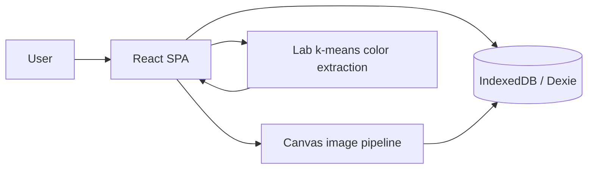
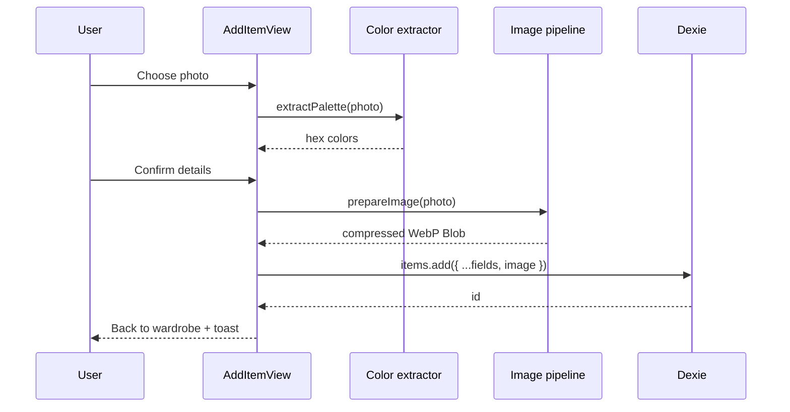

# Architecture

## Current shape (M0)



There is no backend, no account, and no network request in the current app. The browser is the product.

## Why local-first

- **Free:** no hosting database, no storage bill, no auth service.
- **Private:** photos never leave the device.
- **Simple:** one static build instead of an API, workers, and a database.
- **Fast:** reading local data does not wait on a network.
- **Honest trade-off:** data lives in one browser profile on one device. Export/import is the escape hatch, and optional sync comes later.

## Components

### `src/App.tsx`

Owns the app shell: active tab, selected item, toast, and the live query to Dexie. It passes callbacks down; feature components stay mostly presentational.

### `src/components/ItemForm.tsx`

One form powers both capture and editing. It seeds state from an optional saved item, validates and compresses a new photo, extracts a palette, and writes with either `items.add` or `items.update`. `AddItemView` wraps it as a page; `ItemDetail` mounts it in edit mode with a cancel path. Replacing a photo only touches the saved Blob when the user saves the form.

### `src/db.ts`

Dexie database named `wardrobe` with three tables:

- `items` — wardrobe pieces
- `outfits` — saved combinations (schema ready, UI later)
- `wearEvents` — wear history and feedback (schema ready, UI later)

Images are stored as `Blob` values inside the item row. The current schema version is 1. Future schema changes must add a new `db.version(n).stores(...)` migration rather than editing version 1.

### `src/lib/images.ts`

1. Validate MIME type and a 20 MB upload ceiling.
2. `createImageBitmap(file)`.
3. Downscale so the longest edge is at most 1600 px.
4. Draw to a canvas and encode WebP at quality 0.86.
5. Store the resulting Blob.

Downscaling keeps IndexedDB usage predictable. The original file is intentionally not kept; if re-processing is needed later, the user can re-upload.

### `src/lib/backup.ts`

A backup is one JSON file with the full item list and each photo embedded as a data URL. `downloadBackup` reads the items in `createdAt` order, converts every Blob, and triggers a browser download. `importBackup` parses and validates the file, converts the images back to Blobs, and bulk-adds them in one transaction.

Import is additive and idempotent: an item is skipped when its `name` + `createdAt` key already exists, so importing the same file twice does not duplicate the wardrobe. Malformed top-level files fail with a readable message; individual malformed items are skipped and counted. Photos make backups personal data, so the UI warns the user to keep the file safe.

### `src/lib/storage.ts`

Wraps `navigator.storage` so the UI never calls it directly. `getStorageUsage` returns usage, quota, and a percentage from `estimate()`, plus the persisted flag; `requestPersistentStorage` asks `persist()` and swallows a rejection. `formatBytes` renders a friendly size, and `isQuotaError` recognises the `QuotaExceededError` family so both save and import can show a specific "out of storage" message instead of a generic failure.

`StorageStatus` renders the meter inside the backup panel and keeps three states distinct: checking, unsupported, and reported. It shows an alert above 85% and, if the browser refuses persistence, tells the user to keep a backup.

### `src/lib/colors.ts`

Color extraction is deterministic and local:

1. Draw the photo to a 160 px canvas.
2. Sample up to roughly 6,000 opaque pixels, skipping transparency.
3. Convert each pixel to CIELAB.
4. Run k-means with `maxColors + 2` clusters for 10 iterations.
5. Sort clusters by population and merge centroids closer than a Lab distance threshold.
6. Convert centroids back to hex.
7. Map each hex to the nearest human-readable color name with CIEDE2000.

This is intentionally simpler than a trained fashion attribute model. It is fast, explainable, and good enough to seed the color field. The user can add or remove colors manually.

### `src/hooks/useObjectUrl.ts`

Creates an object URL for a Blob and revokes it on change/unmount. This avoids leaking memory when the wardrobe re-renders.

## Data flow: add a piece



## Planned pieces

### Cutouts

Two viable approaches, in order of simplicity:

1. **Local helper (M1):** a Python script or small FastAPI service using `rembg` and/or SAM to produce transparent PNG cutouts. The app imports the cutout next to the original.
2. **In-browser (later):** an ONNX/WASM segmentation model. This is better for a phone-only flow but adds model download size, licensing, and performance constraints.

Do not let cutout research block the catalog UI. The app already works without it.

### Weather

Open-Meteo, fetched directly from the browser:

- `current` / `hourly` feels-like temperature
- precipitation probability
- wind speed
- UV index (optional)

Only coordinates are sent. Cache the response for 30–60 minutes. The module boundary should make it possible to swap providers without touching the recommendation logic.

### Recommendation pipeline (M3)

```text
hard filters
  occasion + formality range
  season + weather band
  status = clean
  not worn in the last N days
        ↓
candidate generation
  top + bottom, or dress
  shoes
  optional outerwear
  optional accessory
        ↓
scoring
  color harmony (Delta E + neutral anchors)
  formality consistency
  warmth vs feels-like
  user preference weights
  novelty / recency
        ↓
top 3 + explanation
```

The first version is rules-based. With one user and a small wardrobe, learned ranking has nothing to learn from. Log feedback (`wore`, `skipped`, `loved`) and only consider weights later once there is enough history.

### Deployment

The Vite build is static. `base: './'` makes it portable to a GitHub Pages project URL (`https://<user>.github.io/wardrobe/`). The planned workflow builds `dist/` and deploys it with GitHub Pages. No server runtime is needed.

## Security and privacy

- No secrets or API keys exist in the client.
- No user photos are uploaded.
- Weather coordinates are the only planned network payload.
- Export files will contain personal wardrobe data; warn the user before sharing.
- If sync is added, authentication and row-level authorization become mandatory before the first sync.

## Constraints

- IndexedDB quota varies by browser; images should stay compressed.
- Data is per browser profile. Private browsing may evict storage.
- No background processing; heavy image work must stay off the main thread once it grows.
- A static site cannot hide API keys. Prefer keyless APIs or user-supplied keys.
